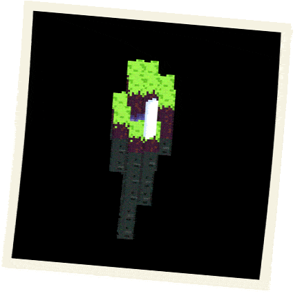

# 5kit

  

  <samp>Systems · Graphics · Low-level programming</samp>

  
  
  

---

### Featured Projects

<table>
  <tr>
    <td width="50%" valign="top">
      <h3>◈ Helix Engine</h3>
      A 3D engine built with Rust and GLSL, with Python bindings.
         
      Rust · GLSL · Python
        
      <a href="https://github.com/5kit/HelixEngine">View repository →</a>
      
~

    </td>
    <td width="50%" valign="top">
      <h3>⌘ Rust HTTP Server</h3>
      A multithreaded HTTP server exploring TCP, request handling, thread pools, and graceful shutdown.
        
      Rust · TCP · Concurrency
        
      <a href="https://github.com/5kit/RustNetcode">View repository →</a>
      
~

    </td>
  </tr>
</table>

---

  <a href="https://www.linkedin.com/in/ismail-syed-636270243/">LinkedIn</a>
  &nbsp;·&nbsp;
  <a href="https://github.com/5kit?tab=repositories">All projects</a>

